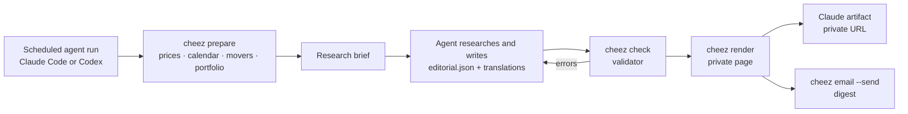

<p align="center">
  
</p>

<h1 align="center">Cheez Daily</h1>

<p align="center">
  A private, read-only morning market briefing, researched by an AI agent and checked by code.<br>
  In English, 繁體中文 or 简体中文 · on a private page and in your inbox · ready before you start your day.
</p>

---

Every US trading day Cheez publishes one edition you can **scan in thirty
seconds** and **read in eight minutes**:

| | |
|---|---|
| **In 30 seconds** | Three or four lines: what happened and what to do about it. |
| **Today's playbook** | The few names worth acting on today, one card each: the stock, its three-month chart with the entry zone and invalidation drawn in, today's move, 1- and 3-month returns, *why*, the *outlook*, and the plan (entry zone · invalidation · target · reward ÷ risk). |
| **The brief** | The developments that matter, why, and what is not yet known, with sources beside each claim. |
| **Markets** | A pulse strip plus US, European and Asian indices, futures, yields, FX and commodities, each with a sparkline, its session and what its change is measured against. |
| **Stocks in focus · Ideas** | The full reasoning behind every card: catalyst, conditions before acting, scenarios, costs and risks, and the strongest case against. |
| **Your portfolio** | Read-only from Longbridge: allocation, concentration, cash by currency (never margin), open orders, how today's ideas fit. |
| **Idea record** | Every published idea, never edited, with what happened next. |

**Numbers come from code; the agent researches and writes; a validator decides
what is publishable.** It rejects levels not anchored to computed prices,
certainty language, shorting, margin, options, position sizes and personalised
calls made without portfolio data. Zero ideas is an acceptable answer.

## Reader settings

On the page (the slider icon, top right), each reader chooses:

- **Language**: English, 繁體中文, 简体中文. The agent writes all three; a
  translation can change words but never a number, ticker or level.
- **Also show prices in**: off by default, or USD, GBP, EUR, HKD, CNY, TWD,
  JPY, SGD, AUD, CAD, CHF, KRW. Every price, including dollar amounts inside
  the prose, gets a small ruby annotation such as <ruby>169.22<rt>≈£128.95</rt></ruby>.
- **Theme**: auto, light, dark.

The defaults for those, the delivery time, your timezone and email live in
[settings](docs/CONFIGURATION.md).

## When it arrives

By default the brief is ready at **07:00 your time** (Europe/London out of the
box): the scheduled run starts at 06:20, so you read it with breakfast, before
Europe opens and seven and a half hours before the US open. Change it with one
line:

```toml
[schedule]
deliver_at = "06:30"
timezone = "Asia/Taipei"
```

`cheez schedule` then prints the matching cron line and task prompt. An
edition is always for the US session that opens on your local date, so an
Asian-morning edition covers that evening's US session.

## Quick start

```bash
git clone https://github.com/czlin7/cheez && cd cheez
python3 -m venv .venv && . .venv/bin/activate
pip install -e '.[dev]'
cheez demo                 # fictional edition → var/demo/site-demo/cheez-daily.html (+ email.html)
cheez config init          # writes cheez.toml (gitignored); edit time, timezone, languages, email
cheez schedule             # cron line + prompt for a Claude Code scheduled task
```

Then follow [docs/SCHEDULING.md](docs/SCHEDULING.md) to have Claude (or an
OpenAI Codex agent) produce it every weekday, and [docs/EMAIL.md](docs/EMAIL.md)
to have it land in your inbox like a newsletter.

## How it works



See [docs/ARCHITECTURE.md](docs/ARCHITECTURE.md) for the code layout and data
flow.

## Commands

```text
cheez prepare [--trigger scheduled|manual] [--force] [--state-from PAGE]   facts + research brief
cheez add-stocks TICKER ...       verify identity and add facts for more tickers
cheez refresh                     re-fetch prices for the edition in progress
cheez check                       validate var/editions/<id>/editorial.json
cheez render [--closed]           build the page (var/site/index.html)
cheez email [--send] [--force]    build the email digest; --send delivers it
cheez fail "reason"               publish a labelled market-data-only edition
cheez config [show|init|path]     settings in effect, or write a starter cheez.toml
cheez schedule [--agent codex]    cron line and scheduled-task prompt for your delivery time
cheez status                      recent runs
cheez demo                        fictional demonstration edition (var/demo/)
cheez brokerage-check             show the read-only token's scopes and expiry
cheez brokerage-authorize         one-time: exchange a Longbridge Agent Auth Code (read-only scopes only)
```

## Documentation

| | |
|---|---|
| [Configuration](docs/CONFIGURATION.md) | Every setting: delivery time, timezone, languages, currency, email |
| [Scheduling](docs/SCHEDULING.md) | Running it daily with Claude Code or an OpenAI Codex agent |
| [Email](docs/EMAIL.md) | Inbox delivery by SMTP (Gmail, Outlook) or Resend |
| [Setup](docs/SETUP.md) | One-time steps: read-only Longbridge connection, data-source decision |
| [Operations](docs/OPERATIONS.md) | Daily timetable, manual refresh, pause, status, costs, maintenance |
| [Architecture](docs/ARCHITECTURE.md) | Code layout, data contracts, how an edition is built |
| [Security](docs/SECURITY.md) | The read-only boundary, data flows, privacy |
| [Decisions](docs/DECISIONS.md) | Why things are the way they are |

## Development

```bash
pip install -e '.[brokerage,dev]'
python -m pytest -q
node scripts/screenshot.cjs var/demo/site-demo/cheez-daily.html screenshots/   # phone/laptop, light/dark
```

This repository is public. Editions, portfolio data, settings with your email
address and tokens never enter it: everything private stays under the
gitignored `var/` directory, in `cheez.toml` (gitignored), in the cloud
environment, or in the private artifact.

Cheez is a research tool, not investment advice, and it never places or
changes orders.
